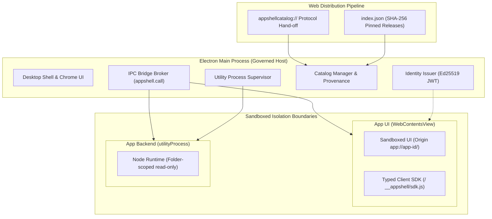

# Appshell

<p align="center">
  <br />
  <strong>One governed desktop shell for many independently delivered apps.</strong>
</p>

Appshell is an Electron-based desktop platform where core and third-party mini-apps live in their own repositories, release by git tag, and run inside isolated sandboxes. Apps are cataloged in [appshell-apps](https://github.com/samuelek25k/appshell-apps) and installed on-demand with zero host code modifications.

---

## Architecture



---

## Isolation Guarantees

Every security boundary is enforced at the OS/runtime level and continuously validated by `test/e2e/hostile.test.js`:

| Boundary | Enforcement Mechanism | Adversarial Protection |
| :--- | :--- | :--- |
| **UI** | Sandboxed `WebContentsView`, own origin `app://<id>/`, isolated session partition | No Node.js integration, no host IPC, storage partitioned |
| **Filesystem** | Partition protocol handler resolves symlinks and serves only the app directory | Path traversal outside the app directory blocked (404) |
| **Network** | Declarative host allowlist in `manifest.capabilities.network` mirrored in CSP | All undeclared external network requests aborted |
| **Backend** | `utilityProcess` restricted by Node Permission Model (`--permission`) | Read-only app directory; zero child processes or worker threads |
| **Identity** | Host signs short-lived (5-min) Ed25519 JWTs with audience `app:<id>` | Apps cannot impersonate peers; credentials never leak to clients |
| **Widgets** | Pure JSON descriptors (`widget.schema.json`) rendered natively by shell | No third-party HTML/JS execution on dashboard |

---

## Quickstart

### Running the Shell
```bash
pnpm install
pnpm start          # Runs Appshell with apps loaded from ../appshell-apps
pnpm check          # Type checks with TypeScript (checkJs)
pnpm test           # Unit, contract and decoupling test suite
pnpm e2e            # 21-vector hostile-app isolation test gate
```

### Developing Apps (`packages/cli`)
```bash
# Scaffold a new sandboxed app with UI, backend & widget
pnpm appshell create ../my-app --id my-app --title "My App"

# Run in an isolated development shell
pnpm appshell dev ../my-app

# Package app into verified tarball with SHA-256 digest
pnpm appshell package ../my-app

# Add release entry to catalog
pnpm appshell catalog add index.json --app ../my-app --repository <url> --url <release-url> --sha256 <hex> --commit <sha>
```

---

## Products & Multi-Tenancy

Appshell can be branded as a distinct product via a single `product.json`:
- Configures product name, deep-link protocol (`<protocol>://`), and data directory.
- Sets pre-installed apps and security policy (`enforce` vs `warn`).
- Reference configuration: `products/appshell/product.json`.

---

## Documentation

- **Platform Contract**: [`docs/contracts.md`](docs/contracts.md) (API methods, events, and schemas)
- **Decision Register**: [`docs/decisions.md`](docs/decisions.md) (Architectural decisions D1–D21)
- **Engineering Principles**: [`AGENTS.md`](AGENTS.md) (Rules, liability, and verification gates)
- **App Store**: [samuelek25k.github.io/appshell-apps](https://samuelek25k.github.io/appshell-apps/)
- **Product Site**: [samuelek25k.github.io/appshell](https://samuelek25k.github.io/appshell/)
